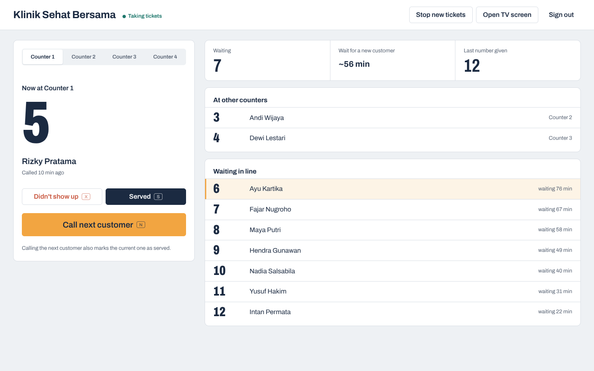
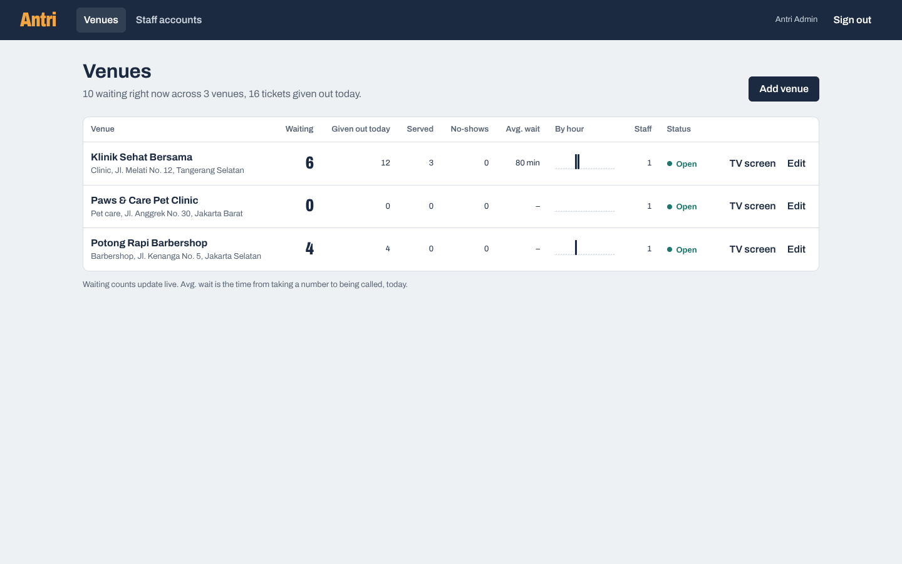
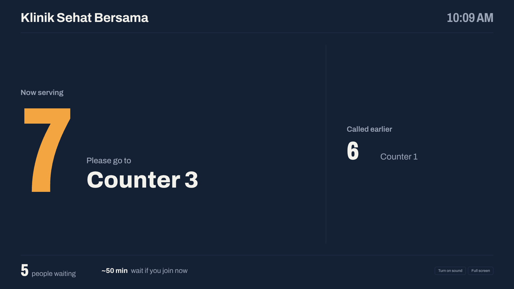
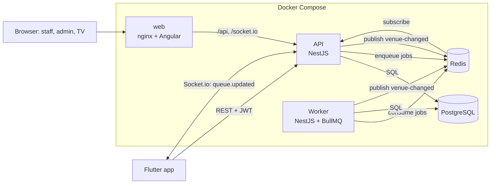

# Antri: virtual queue app

*Antri* (Indonesian for "queue") is a take-a-number system for clinics, barbershops, pet clinics and service counters. Customers join a queue from their phone and watch their position move live. Staff call the next number from the counter, and a TV in the waiting room shows who is being served.

| | |
|---|---|
| **Mobile** (customers, staff) | Flutter, Riverpod, Dio, Socket.io client |
| **Web** (staff, admins, TV screen) | Angular (standalone components, signals, zoneless), Socket.io client, Vitest |
| **Backend** | NestJS (TypeScript), PostgreSQL, Redis, BullMQ, Socket.io |
| **Infra** | Docker (multi-stage images), nginx, Docker Compose, GitHub Actions CI |



## What it does

**Customers**
- Browse venues with live waiting counts and estimated wait time
- Take a number; double taps and network retries never create two tickets
- Watch their ticket update in real time: people ahead, estimated wait, "it's your turn, go to Counter 2"
- Get alerts when they are almost up, when they are called, and if they were skipped

**Staff** (mobile app or web console)
- Call the next customer to a counter (several counters can call at the same moment)
- Mark customers served or no-show; keyboard shortcuts on the web (N, S, X)
- Open or close the queue
- Each browser remembers which counter it belongs to

**Waiting-room TV** (web, no sign-in)
- Shows the number being called and where to go, plus earlier calls and the line length
- Updates live, plays a chime on each new call, and reconnects by itself after network drops

**Admins** (web)
- Add and edit venues, open or close them
- Create and remove staff accounts
- Today's numbers per venue: tickets given out, served, no-shows, average wait, tickets per hour

| Admin: venues | TV screen |
|---|---|
|  |  |

## Architecture



- **web** is nginx serving the built Angular app. It forwards `/api` and `/socket.io` to the API, so the browser talks to a single origin: no CORS setup and no API URL baked into the build.
- **API** handles HTTP and WebSockets. It never does slow work in the request path.
- **Worker** is a separate process built from the same image. It sends "you're almost up" notifications and runs a sweep every minute (no-shows, expired tickets). It scales independently of the API.
- **Redis pub/sub** carries "venue changed" events, so live updates work no matter which API replica or the worker made the change.

## The interesting parts

These are the problems a real queue system has to get right, and how this project solves them. Each one is covered by an automated test against a real PostgreSQL.

### 1. No duplicate or skipped ticket numbers under load
Forty people tapping "Take a number" at the same second must get 1 to 40, with no gaps and no duplicates. Number assignment takes a **transaction-scoped advisory lock** per venue (`pg_advisory_xact_lock`), and a unique constraint `(venue_id, service_date, number)` backs it up.
→ [`tickets.service.ts`](backend/src/tickets/tickets.service.ts), test: *issues gap-free, unique numbers when 40 customers join at the same moment*

### 2. Idempotent "join" over a flaky mobile network
The app sends an `Idempotency-Key` header. If the response is lost and the app retries with the same key, the server returns the original ticket (`200` + `Idempotent-Replayed: true`) instead of creating a second one. The key is re-checked *after* taking the lock, so even 10 identical requests in flight produce exactly one ticket. On the app side, the key is kept only while the outcome is unknown (network error) and dropped after any definite answer.
→ test: *creates exactly one ticket when the same request is fired 10 times in parallel*

### 3. Several counters calling at once
"Call next" is a single `UPDATE … FROM (SELECT … FOR UPDATE SKIP LOCKED)`. Concurrent callers skip rows another transaction has already claimed, so no two counters get the same customer and nobody waits on a lock.
→ test: *never gives the same ticket to two counters calling at the same time*

### 4. The ticket state machine lives in SQL
`WAITING → CALLED → SERVED | NO_SHOW`, or `WAITING → CANCELLED`. Every transition is a conditional `UPDATE … WHERE status = '<expected>'`, so an invalid or racing transition changes nothing and returns `409 INVALID_TRANSITION`.

### 5. Retry-safe background jobs
BullMQ retries failed jobs with exponential backoff, so every job must be safe to run twice. Notifications have a unique `(ticket_id, type)` key and tickets a `notified_at` flag, so a retried job never notifies twice.
→ [`notifications.processor.ts`](backend/src/jobs/notifications.processor.ts), test: *notifies the next customers once, even when the job runs again*

### Also
- "Today" is computed in each venue's own time zone, so queues reset at local midnight.
- Estimated wait uses the venue's measured service speed once enough customers were served today.
- Migrations are plain SQL, applied under an advisory lock so several containers can start at once.
- One error shape everywhere: `{ statusCode, code, message }`. The app switches on `code`.
- The Docker image is multi-stage, ships only production dependencies, and runs as a non-root user.

## Run it

### Backend (Docker)
```bash
cp .env.example .env          # optional; defaults work locally
docker compose up --build
```
- Web dashboard: http://localhost:8080
- API: http://localhost:3000
- Swagger docs: http://localhost:3000/docs
- Health: http://localhost:3000/health

Demo accounts (password `password123`):

| Email | Role |
|---|---|
| `admin@antri.dev` | Admin (web) |
| `demo@antri.dev` | Customer (mobile app) |
| `staff.clinic@antri.dev` | Staff, Klinik Sehat Bersama |
| `staff.barber@antri.dev` | Staff, Potong Rapi Barbershop |
| `staff.pets@antri.dev` | Staff, Paws & Care Pet Clinic |

### Web dashboard (development)
```bash
cd web
npm ci
npm start                      # http://localhost:4200, proxies /api and /socket.io to localhost:3000
```
Sign in as clinic staff, press **Open TV screen**, then press **N** in the staff console and watch the TV screen change.

### Mobile app
Requires the Flutter SDK (3.27 or newer).
```bash
cd mobile
./tool/setup_platforms.sh     # once: generates android/ and ios/, allows http to your local API
flutter run                    # Android emulator: talks to http://10.0.2.2:3000 by default
```
For the iOS simulator or a real phone, pass the backend address:
```bash
flutter run --dart-define=API_URL=http://localhost:3000        # iOS simulator
flutter run --dart-define=API_URL=http://192.168.1.10:3000     # real phone: your computer's LAN IP
```
**Try it:** sign in as the customer on one device (or emulator) and as clinic staff on another. Take a number, then press "Call next" on the staff side and watch the customer's ticket change instantly.

### Tests
The backend tests need PostgreSQL and Redis, because concurrency can't be tested against mocks.
```bash
docker compose up -d postgres redis
docker compose exec postgres createdb -U antri antri_test
cd backend && npm ci && npm test
```
```bash
cd web && npm test             # Vitest: guards, error mapping, staff console behaviour, charts
cd mobile && flutter test
```
CI runs all of this on every push: backend build and tests against real Postgres and Redis services, the Angular build and tests, both Docker images, compose validation, and Flutter analyze and test.

## API

| Method | Path | Who | |
|---|---|---|---|
| POST | `/auth/register`, `/auth/login` | anyone | Returns a JWT |
| GET | `/venues`, `/venues/:id` | anyone | Venues with live queue stats |
| POST | `/venues/:id/tickets` | customer | Take a number. Header `Idempotency-Key` required |
| GET | `/tickets/me`, `/tickets/:id` | customer | Tickets with position and estimated wait |
| POST | `/tickets/:id/cancel` | customer | Leave the queue |
| GET | `/notifications/me` | signed in | Alerts |
| GET | `/staff/queue` | staff | Waiting and called lists for the staff's venue |
| POST | `/staff/call-next` | staff | `{ counter }` |
| POST | `/staff/tickets/:id/finish` | staff | `{ outcome: "SERVED" \| "NO_SHOW" }` |
| PATCH | `/staff/venue` | staff | `{ isOpen }` |
| GET | `/admin/overview` | admin | Every venue with live state and today's numbers |
| POST, PATCH | `/admin/venues`, `/admin/venues/:id` | admin | Add or edit a venue |
| GET, POST, DELETE | `/admin/staff`, `/admin/staff/:id` | admin | Staff accounts |

**WebSocket** (Socket.io): emit `venue.join` with a venue id, then receive `queue.updated` snapshots.

Full, interactive docs are at `/docs` while the API runs.

## Project layout
```
backend/
  migrations/          plain SQL migrations
  src/
    auth/              JWT auth, global guard, roles
    tickets/           join, call next, finish, cancel, staff console, notifications API
    venues/            venue list and live snapshot query
    realtime/          Socket.io gateway, Redis pub/sub
    jobs/              BullMQ producer, worker, retry-safe job handlers
    db/                connection pool, migration runner, demo seed
    main.ts            API entry point
    worker.ts          worker entry point
  test/                end-to-end tests against real Postgres and Redis
  Dockerfile
web/
  src/app/
    core/              API client, auth (signals, interceptor, guards), live socket service
    pages/             login, staff console, admin (venues, staff), TV display
    ui/                small shared components (tickets-per-hour chart)
  nginx.conf           serves the app, proxies /api and /socket.io
  Dockerfile
mobile/
  lib/
    core/              API client, socket, repository (Riverpod providers), theme
    features/          auth, customer screens, staff console
    models/            JSON models
    widgets/           ticket stub and shared widgets
docker-compose.yml
.github/workflows/ci.yml
```

## Ideas for next steps
- Real push notifications with Firebase Cloud Messaging (replace `PushSender`)
- Show a QR code on the TV screen that opens the venue in the app
- Deploy to a cloud provider (for example Google Cloud Run with Cloud SQL and Memorystore)
- Rate limiting on join, and refresh tokens

## License
MIT
